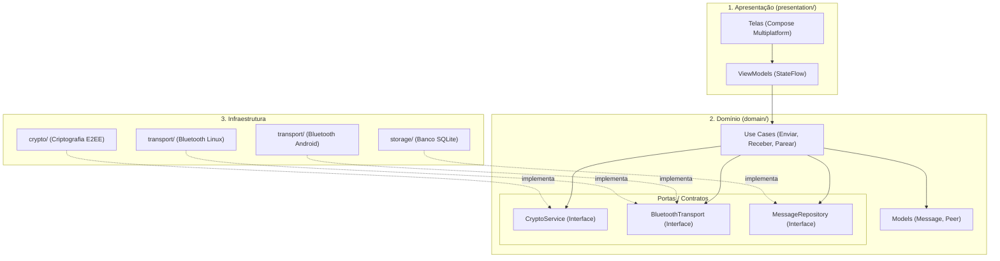
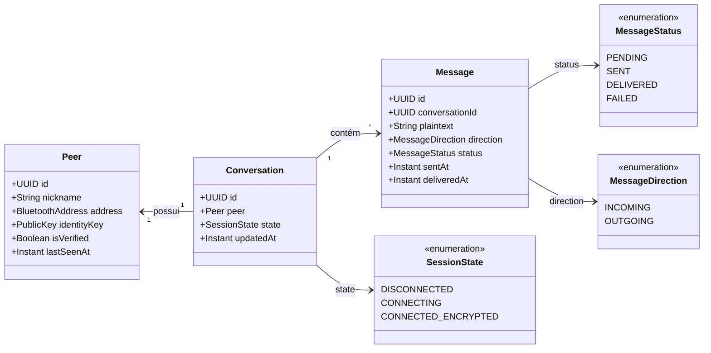

# Arquitetura e Estrutura de Diretórios — Blue Messenger

## 1. Padrão Arquitetural Adotado
O projeto adota **Clean Architecture + Hexagonal (Ports & Adapters)** sobre **Kotlin Multiplatform (KMP)** e **Compose Multiplatform** (ou UI compartilhada/modular), dividindo claramente:
- **Core Compartilhado (`shared / commonMain`)**: Domínio puro, protocolo de framing/serialização Bluetooth, casos de uso, gerenciamento de estado (MVI/MVVM) e persistência multiplataforma.
- **Adaptadores de Plataforma (`androidMain` e `jvmMain` para Linux)**: Implementações concretas do transporte Bluetooth (`android.bluetooth.BluetoothAdapter` no Android; BlueZ D-Bus / BlueCove / Socket nativo AF_BLUETOOTH no Linux) e armazenamento local.



---

## 2. Mapeamento Explícito de Diretórios

```text
blue-messenger/
├── build.gradle.kts
├── settings.gradle.kts
├── gradle.properties
├── docs/                                  # Documentação viva do projeto
│   ├── ARCHITECTURE.md
│   ├── CODING_GUIDELINES.md
│   ├── SPECIFICATION.md
│   ├── SYSTEM_STATE.md
│   └── TEMPLATE_TAREFA.md
├── shared/                                # Módulo KMP principal (Lógica, Protocolo, Domínio e UI compartilhada)
│   ├── build.gradle.kts
│   └── src/
│       ├── commonMain/kotlin/com/bluemessenger/
│       │   ├── domain/
│       │   │   ├── model/                 # Entidades imutáveis de negócio (Peer, Conversation, Message, LocalIdentity)
│       │   │   ├── constants/             # Constantes de regras de sessão e casos de uso (SessionConstants)
│       │   │   ├── primitives/            # Primitivas de domínio / VOs imutáveis (BluetoothAddress, DomainId, Instant, PublicKey)
│       │   │   ├── enums/                 # Enums e máquinas de estado (SessionState, MessageStatus, MessageDirection)
│       │   │   ├── error/                 # Erros e exceções do domínio (DomainError, DomainException)
│       │   │   ├── concurrency/           # Abstração de threads para testes (CoroutineDispatchers)
│       │   │   ├── ports/                 # Portas (contratos com a infraestrutura) organizadas por fronteira e responsabilidade
│       │   │   │   ├── crypto/            # Portas criptográficas (CryptoService, KeyStoreProvider)
│       │   │   │   │   └── model/         # Modelos de contrato da porta crypto (HandshakeStepResult)
│       │   │   │   ├── logging/           # Porta de observabilidade estruturada sem vazar segredos (AppLogger)
│       │   │   │   ├── transport/         # Portas de Bluetooth (BluetoothTransport, BluetoothScanner)
│       │   │   │   │   ├── model/         # Modelos de pacote da porta de transporte (Packet)
│       │   │   │   │   └── constants/     # Constantes de protocolo/serviço da porta de transporte (TransportConstants)
│       │   │   │   └── storage/           # Interfaces de persistência (MessageRepository, PeerRepository, IdentityRepository)
│       │   │   └── usecase/               # Casos de uso de negócio por subdomínio
│       │   │       ├── peer/              # Identidade, descoberta, conversas e Safety Numbers (InitializeIdentity, DiscoverPeers, ObserveConversations, VerifyPeerSafetyNumber)
│       │   │       ├── session/           # Handshake E2EE, Keep-Alive e reconexão (EstablishSecureSession, ManageKeepAliveAndReconnect)
│       │   │       └── message/           # Envio, histórico/observação, recebimento/ACK e fila offline (SendMessage, ObserveMessages, ObserveIncomingFrames, FlushPendingMessages, util/)
│       │   ├── crypto/                    # Motor Criptográfico Concreto (DefaultCryptoService, NoiseXxHandshake, DoubleRatchetSession, ChaCha20Poly1305Cipher, SafetyNumberGenerator)
│       │   │   ├── model/                 # Modelos criptográficos (IdentityKeyPair, EphemeralKeyPair, RatchetHeader)
│       │   │   ├── constants/             # Constantes criptográficas (CryptoConstants)
│       │   │   └── util/                  # Utilitários criptográficos (ByteArrayZeroizer, KdfChain, expect CryptoPrimitives)
│       │   ├── transport/                 # Adaptadores de transporte e motor binário interno
│       │   │   └── protocol/              # Codec binário e framing CRC32 (PacketCodec, FrameEncoder, FrameDecoder)
│       │   │       ├── util/              # Utilitários de apoio binário (Crc32Checksum, BigEndianBytes)
│       │   │       ├── constants/         # Constantes de protocolo e opcodes (FrameConstants, PacketConstants)
│       │   │       └── error/             # Erros tipados de framing e pacote (FrameError, PacketError)
│       │   ├── storage/                   # Persistência Local Multiplataforma (SQLDelight)
│       │   │   ├── repository/            # Implementações de repositório (SqlDelightMessageRepository, etc.)
│       │   │   └── mapper/                # Mappers entre registros SQLDelight e entidades imutáveis de domínio (PeerMapper, ConversationMapper, MessageMapper, IdentityMapper)
│       │   └── presentation/
│       │       ├── chat/                  # State, Intent/Event e ViewModel/Store da conversa
│       │       └── discovery/             # State, Intent/Event e ViewModel/Store de busca de pares
│       ├── commonTest/kotlin/com/bluemessenger/
│       │   ├── domain/                    # Testes unitários de regras de negócio e use cases
│       │   ├── transport/protocol/        # Testes de framing, fragmentação e serialização
│       │   └── crypto/                    # Testes de AEAD, Noise XX, Double Ratchet e Safety Numbers
│       ├── jvmCommonMain/kotlin/com/bluemessenger/ # Source set compartilhado entre androidMain e jvmMain (evita duplicação JVM)
│       │   └── crypto/util/               # Implementação actual única de CryptoPrimitives via BouncyCastle Lightweight
│       ├── androidMain/kotlin/com/bluemessenger/
│       │   ├── crypto/                    # AndroidKeyStoreProvider
│       │   ├── logging/                   # AndroidAppLoggerImpl (android.util.Log)
│       │   ├── transport/android/         # Implementação RFCOMM/BLE com android.bluetooth.*
│       │   └── di/                        # Wiring de dependências específicas do Android
│       ├── androidUnitTest/kotlin/com/bluemessenger/
│       ├── jvmMain/kotlin/com/bluemessenger/
│       │   ├── crypto/                    # LinuxSecretServiceKeyStoreProvider
│       │   ├── logging/                   # JvmAppLoggerImpl (java.util.logging.Logger)
│       │   ├── transport/linux/           # Implementação Bluetooth no Linux (BlueZ / DBus / Native Socket)
│       │   └── di/                        # Wiring de dependências específicas do Linux Desktop
│       └── jvmTest/kotlin/com/bluemessenger/
├── androidApp/                            # Entrypoint Android (Activity, AndroidManifest, Permissões)
│   ├── build.gradle.kts
│   └── src/main/
└── desktopApp/                            # Entrypoint Linux Desktop (MainKt, janela Compose Desktop / CLI)
    ├── build.gradle.kts
    └── src/jvmMain/kotlin/com/bluemessenger/desktop/
```

---

## 3. Diagrama do Modelo de Domínio (Domain Model)

Em consonância com as práticas de *Domain-Driven Design (DDD)* e *UML Distilled (Martin Fowler)*, o diagrama estrutural abaixo foca estritamente na **Perspectiva Conceitual e Entidades de Domínio** (`com.bluemessenger.domain.model`). Ele expressa a Linguagem Ubíqua, os estados do ciclo de vida e as cardinalidades de negócio do Blue Messenger, sem poluição de controladores, codecs ou adaptadores técnicos:



---

## 4. Limites entre Camadas e Regras de Dependência

1. **`domain` não depende de ninguém**:
   - O pacote `com.bluemessenger.domain.*` contém apenas **Entidades**, **Casos de Uso** e **Portas (Interfaces)**.
   - Pode importar apenas a biblioteca padrão do Kotlin (`kotlin.*`) e `kotlinx.coroutines.*`.
   - É estritamente proibido importar `android.*`, bibliotecas de banco de dados, bibliotecas externas de criptografia ou frameworks de UI dentro de `domain`.
2. **`crypto`, `storage` e `transport` implementam as 3 portas principais definidas no `domain`** (além de adaptadores nativos de `logging`):
   - `crypto/` implementa o contrato `CryptoService` (utilizando Double Ratchet, X25519 e ChaCha20-Poly1305).
   - `storage/` implementa `MessageRepository`, `PeerRepository` e `IdentityRepository` (utilizando SQLDelight/SQLite).
   - `androidMain/transport/android/` e `jvmMain/transport/linux/` implementam `BluetoothTransport` (trocando `Packet` tipados) e `BluetoothScanner` para Android SDK e Linux BlueZ respectivamente.
   - `androidMain/logging/` e `jvmMain/logging/` implementam `AppLogger` nativamente sem dependências externas (`AndroidAppLoggerImpl` via `android.util.Log` e `JvmAppLoggerImpl` via `java.util.logging.Logger`).
3. **`transport/protocol` é o motor binário interno de fio e framing dos adaptadores `transport`**:
   - Responsável pela codificação/decodificação de pacotes (`PacketCodec`) e frames binários com prefixo de tamanho e validação de integridade CRC32 (`FrameEncoder`, `FrameDecoder`) consumidos exclusivamente pelas implementações de `BluetoothTransport`.
4. **`presentation` conversa apenas com `domain`**:
   - ViewModels/StateHolders consomem Use Cases e expõem estados imutáveis (`StateFlow<UiState>`) para as telas Compose Multiplatform.
