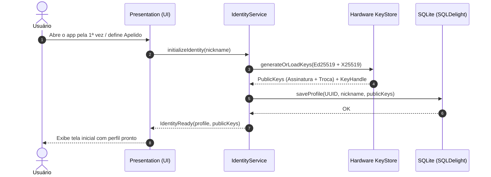
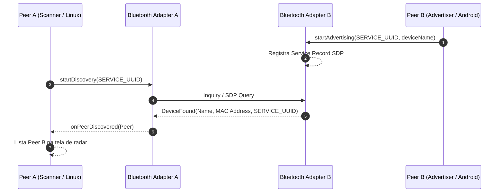
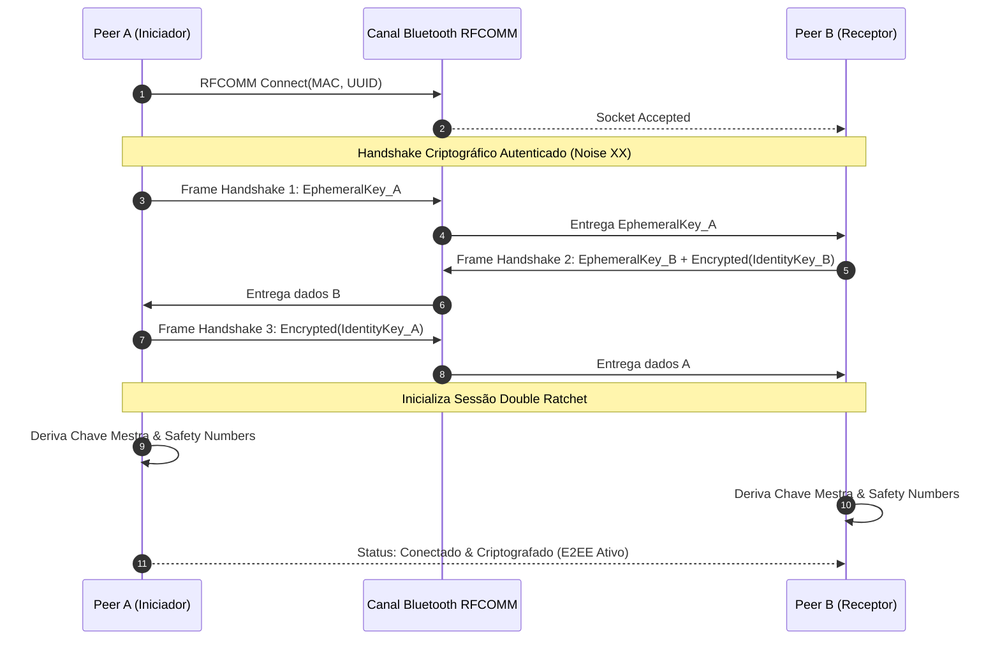
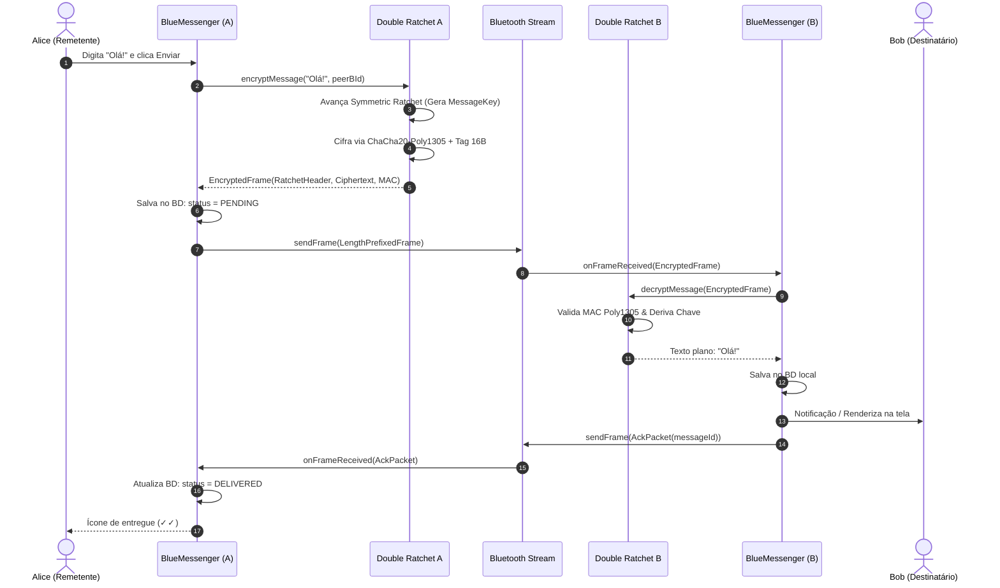
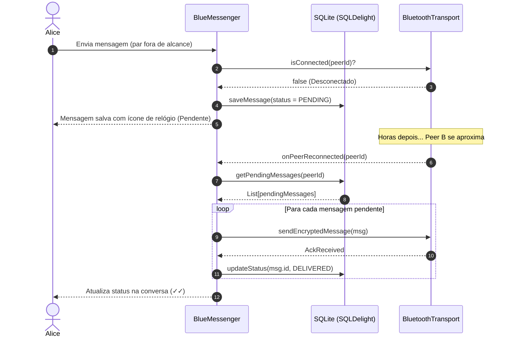
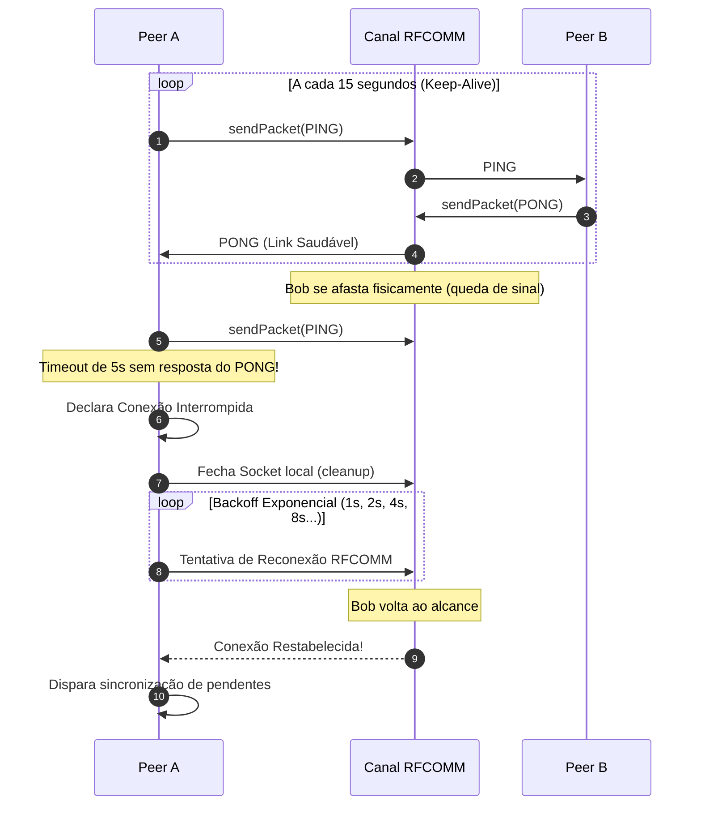
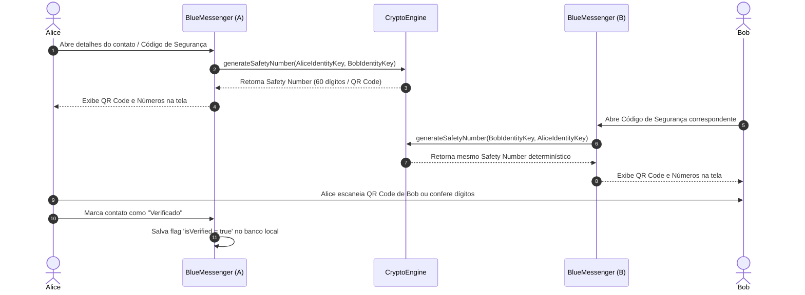
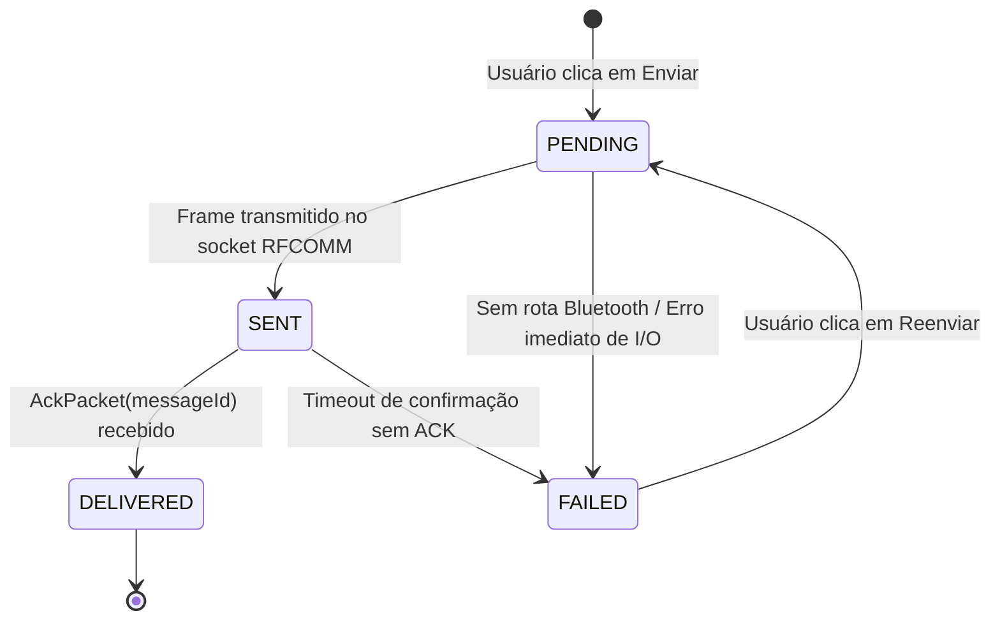
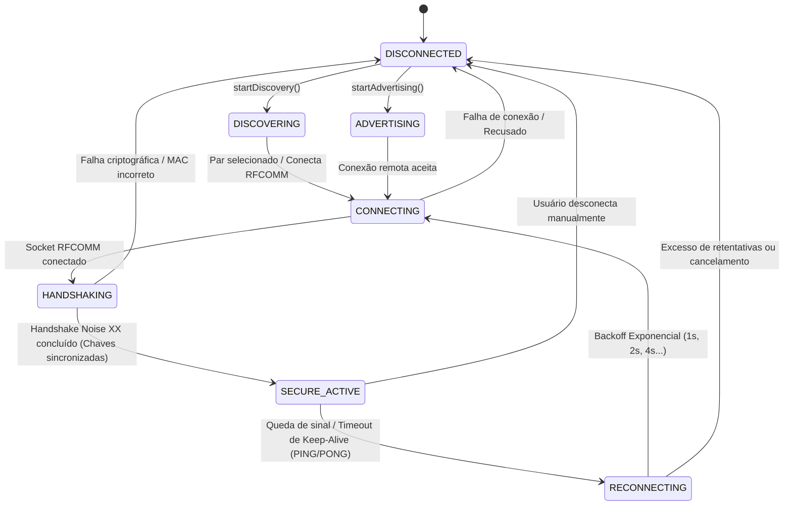

# Especificação do Sistema — Blue Messenger

## 1. Visão Geral e Propósito do Sistema
O **Blue Messenger** é um aplicativo de mensagens instantâneas ponto a ponto (P2P) via **Bluetooth** (Bluetooth Classic RFCOMM / BLE) desenvolvido em **Kotlin Multiplatform (KMP)** com suporte nativo e interoperável entre **Linux (Desktop/JVM)** e **Android**.

O objetivo principal é permitir comunicação local rápida, offline e resiliente entre dispositivos Linux e Android próximos, sem depender de servidores centrais, internet ou infraestrutura de rede Wi-Fi.

---

## 2. Requisitos Funcionais (RF) e Casos de Uso Principais

- **RF01 — Identidade Local do Usuário**:
  - Configurar perfil local (apelido/nickname, identificador único UUID e chave pública opcional para verificação de par).
- **RF02 — Descoberta e Pareamento de Dispositivos (Discovery & Advertising)**:
  - Escanear dispositivos próximos executando o serviço UUID do Blue Messenger tanto no Android quanto no Linux (via BlueZ / D-Bus ou sockets RFCOMM).
  - Tornar o dispositivo visível/anunciando o serviço SDP (Service Discovery Protocol) ou GATT do Blue Messenger.
- **RF03 — Conexão Bidirecional Entre Plataformas (Linux ↔ Android, Android ↔ Android, Linux ↔ Linux)**:
  - Estabelecer canais RFCOMM / L2CAP orientados a stream ou pacotes com handshake de protocolo.
  - Suportar modo servidor (escutando conexões de entrada) e modo cliente (iniciando conexão ao par selecionado).
- **RF04 — Troca de Mensagens de Texto em Tempo Real**:
  - Envio e recebimento de mensagens de texto UTF-8 com confirmação de entrega (`ACK`) e status da mensagem (`PENDING`, `SENT`, `DELIVERED`, `FAILED`).
- **RF05 — Persistência do Histórico de Conversas**:
  - Armazenar localmente histórico de mensagens e contatos pareados/conhecidos (SQLDelight / Room KMP) para consulta offline e reenvio quando reconectado.
- **RF06 — Reconexão e Keep-Alive**:
  - Monitorar o estado da conexão via pacotes de `PING/PONG`, detectando desconexões abruptas e permitindo reconexão automática ou manual.
- **RF07 — Criptografia de Ponta a Ponta (E2EE — Estilo Signal / WhatsApp)**:
  - **Identidade e Chaves Criptográficas**: Cada nó gera um par de chaves de identidade de longo prazo (Ed25519) e chaves Diffie-Hellman (X25519 / Curve25519).
  - **Acordo de Chaves P2P (Handshake Autenticado)**: Estabelecer sessão criptográfica segura sem intermediários usando handshake inspirado no Noise Protocol (`Noise_XX`) ou X3DH P2P direto sobre a conexão Bluetooth.
  - **Double Ratchet (Forward Secrecy & Break-in Recovery)**: Utilizar o algoritmo Double Ratchet (catraca Diffie-Hellman + cadeias de derivação KDF simétricas). Cada mensagem enviada utiliza uma chave única efêmera descartada imediatamente após o uso. Se uma chave for exposta, mensagens anteriores e futuras permanecem invioláveis.
  - **Cifragem Autenticada (AEAD)**: Todas as mensagens e metadados sensíveis são cifrados com ChaCha20-Poly1305 (ou AES-256-GCM), garantindo confidencialidade e autenticidade contra adulteração.
  - **Código de Segurança (Safety Numbers / SAS)**: Gerar números de segurança / QR code comparáveis entre os pares para verificação fora de banda contra ataques Man-In-The-Middle (MITM).
  - **Armazenamento Seguro das Chaves Privadas**: Chaves de identidade locais são armazenadas com proteção de hardware (Android Keystore no Android; Secret Service API / chave protegida por passphrase no Linux).

---

## 3. Requisitos Não Funcionais (RNF)

- **RNF01 — Interoperabilidade Multiplataforma**:
  - O protocolo de aplicação (framing binário ou JSON/Protobuf sobre RFCOMM) deve ser 100% compartilhado em `commonMain`, garantindo compatibilidade estrita entre Linux e Android.
- **RNF02 — Concorrência e Não-Bloqueio**:
  - Todas as operações de I/O Bluetooth e banco de dados devem rodar em `Kotlin Coroutines` (`Dispatchers.IO`) e expor fluxos reativos via `Flow` / `StateFlow`, nunca bloqueando a thread de UI (Main Thread).
- **RNF03 — Latência e Resiliência de Pacotes**:
  - Mensagens curtas de texto devem ser entregues em `< 200ms` quando a conexão RFCOMM já estiver ativa.
  - O framing deve delimitar o tamanho da carga útil (Length-Prefixed Frame) e validar integridade (CRC32/Checksum) para evitar leitura parcial ou corrupção no stream Bluetooth.
- **RNF04 — Gerenciamento de Permissões e Hardware**:
  - Tratamento explícito de estados de adaptador desligado, permissões negadas no Android (`BLUETOOTH_SCAN`, `BLUETOOTH_CONNECT`, `BLUETOOTH_advertise`) e ausência de adaptador/permissão no grupo `bluetooth` do Linux.
- **RNF05 — Segurança e Proteção Criptográfica Sem Overhead Excessivo**:
  - O overhead de encriptação (cabeçalho da catraca + tag Poly1305 de 16 bytes) não deve ultrapassar 64–80 bytes por frame, preservando a eficiência da MTU Bluetooth (RFCOMM/L2CAP).
  - O processamento de derivação de chaves e cifragem deve levar `< 5ms` em dispositivos móveis modernos sem travar a thread de processamento de pacotes.

---

## 4. Regras de Negócio e Invariantes do Domínio

1. **Identidade do Protocolo (Service UUID)**:
   - Todo nó do Blue Messenger registra e procura um UUID de serviço RFCOMM canônico e versão de protocolo explícita no handshake inicial.
2. **Idempotência de Mensagens**:
   - Cada mensagem possui um `messageId` (UUID v4/v7) gerado pelo remetente. Receber o mesmo `messageId` mais de uma vez (por retentativa de rede) não deve duplicar a mensagem no histórico do destinatário, apenas reenviar o `ACK`.
3. **Máquina de Estados de Mensagem**:
   - Transições válidas de status de envio: `PENDING -> SENT -> DELIVERED` ou `PENDING -> FAILED` (com possibilidade de `FAILED -> PENDING` em retry).
4. **Isolamento do Transporte**:
   - O domínio (`commonMain`) nunca referencia classes específicas de plataforma (`android.bluetooth.*` ou bibliotecas Linux/BlueZ); toda comunicação ocorre através da interface `BluetoothTransport` definida no domínio.

---

## 5. Diagramas de Sequência dos Requisitos Funcionais

### 5.1. RF01 — Inicialização da Identidade Local e Chaves Criptográficas
Demonstra o fluxo no primeiro boot para derivar o par de chaves assimétricas e persistir na KeyStore do sistema operacional.

---

### 5.2. RF02 — Descoberta e Anúncio de Dispositivos (Discovery & Advertising)
Demonstra como o dispositivo escaneia a vizinhança e localiza o par executando o Blue Messenger.

---

### 5.3. RF03 & RF07 — Conexão, Handshake Autenticado e Inicialização E2EE
Estabelece o canal RFCOMM e executa o handshake de três vias (estilo Noise XX) para autenticação mútua e inicialização do Double Ratchet.

---

### 5.4. RF04 — Troca de Mensagens de Texto Cifradas em Tempo Real
Fluxo de envio de mensagem com avanço da catraca simétrica (KDF), cifragem ChaCha20-Poly1305, envio do frame e confirmação por ACK.

---

### 5.5. RF05 — Persistência Local e Reenvio Offline
Demonstra a tolerância à desconexão física com armazenamento local de mensagens pendentes e reenvio automático ao reencontrar o par.

---

### 5.6. RF06 — Reconexão Automática e Monitoramento de Conexão (Keep-Alive)
Demonstra o monitoramento contínuo via PING/PONG e o ciclo de reconexão automática com backoff exponencial diante de afastamento físico.

---

### 5.7. RF07 — Verificação do Código de Segurança Presencial (Safety Numbers / SAS)
Fluxo de verificação de segurança fora de banda para blindagem completa contra ataques Man-In-The-Middle (MITM).

---

## 6. Diagramas de Máquinas de Estados (State Machines)

### 6.1. Ciclo de Vida da Mensagem (`MessageStatus`)
Define rigorosamente as transições permitidas para o status de envio e entrega de mensagens, proibindo transições inválidas (ex: uma mensagem `DELIVERED` jamais retrocede para `PENDING`).

---

### 6.2. Ciclo de Vida da Sessão de Conexão Bluetooth (`SessionState`)
Modela o comportamento de transição desde a descoberta no ar até a sessão criptografada segura e os ciclos de recuperação automática diante de afastamento físico.

---

## 7. Matriz de Modelo de Ameaças (Threat Model — STRIDE)

Um modelo de ameaças profissional não se limita à rede; ele analisa as três superfícies críticas de um sistema seguro: **Dados em Trânsito** (*Data in Transit*), **Dados em Repouso** (*Data at Rest*) e **Dados em Uso** (*Data in Use*). A matriz abaixo mapeia cada categoria da metodologia **STRIDE** aplicada ao Blue Messenger:

| Categoria STRIDE | Superfície / Escopo | Vetor de Ataque | Impacto Potencial | Mitigação Arquitetural e Criptográfica | Onde no Código é Garantido |
| :--- | :--- | :--- | :--- | :--- | :--- |
| **S - Spoofing** *(Falsificação)* | **Trânsito** *(Bluetooth)* | Atacante próximo anuncia o mesmo nome/MAC fingindo ser Bob. | Comunicação com impostor acreditando ser contato legítimo. | Par de chaves **Ed25519** assinado no handshake + **Safety Numbers (QR Code presencial)**. | `crypto.safety` e `handshake` |
| **S - Spoofing** *(Falsificação)* | **Repouso** *(Chaves Locais)* | Malware no dispositivo tenta substituir o par de chaves por outro par forjado. | Perda da identidade legítima ou usurpação da conta local. | Chaves privadas são ancoradas no **Hardware KeyStore** (TEE/Titan M no Android; Secret Service/Keyring no Linux), inacessíveis para escrita direta. | `domain.transport` e adaptadores de SO |
| **T - Tampering** *(Adulteração)* | **Trânsito** *(Bluetooth)* | Injeção de ruído ou alteração de bits nos pacotes durante a transmissão pelo ar. | Mensagens corrompidas ou comandos maliciosos injetados. | Cifragem autenticada **AEAD (ChaCha20-Poly1305)** com tag MAC de 16 bytes + **CRC32**. Qualquer bit adulterado invalida o frame imediatamente. | `protocol.frame` e `crypto.cipher` |
| **T - Tampering** *(Adulteração)* | **Repouso** *(SQLite)* | Usuário com root ou app malicioso tenta editar mensagens direto no arquivo SQLite. | Falsificação de histórico ou alteração de flags de verificação (`isVerified`). | Criptografia da base de dados (SQLCipher / encriptação de colunas sensíveis) + integridade por assinatura local. | `data.repository` (SQLDelight) |
| **R - Repudiation** *(Repúdio)* | **Trânsito & Repouso** | Remetente nega ter enviado determinada mensagem. | Insegurança sobre a autoria e integridade do histórico. | Mensagens com `UUIDv7`, amarradas à catraca criptográfica efêmera e registradas localmente com carimbo imutável. | `domain.model` e `data.repository` |
| **I - Information Disclosure** *(Vazamento)* | **Trânsito** *(Bluetooth)* | Captura de pacotes no ar via antenas Bluetooth, *Ubertooth* ou *btmon*/Wireshark. | Vazamento de conversas confidenciais e metadados. | **Criptografia de Ponta a Ponta (E2EE)** com **Double Ratchet**. Trafega apenas ruído aleatório ininteligível. | `crypto.ratchet` |
| **I - Information Disclosure** *(Vazamento)* | **Repouso** *(Aparelho Perdido)* | Aparelho é perdido ou furtado fisicamente e o atacante tenta extrair as chaves privadas. | Comprometimento total da identidade do usuário. | **As chaves privadas NUNCA residem em texto plano no disco**. Protegidas pelo chip de hardware com chave não exportável. | `Hardware KeyStore` do SO |
| **I - Information Disclosure** *(Vazamento)* | **Uso** *(Logs e Memória)* | O desenvolvedor ou biblioteca imprime o texto plano da conversa nos logs do sistema (`logcat`/`stdout`). | Vazamento de mensagens privadas para ferramentas de telemetria ou outros apps com permissão de log. | **Proibição estrita em Coding Guidelines** de logar texto plano ou chaves + sobrescrita com zeros (**Zeroize** de `ByteArray`) de chaves efêmeras após o uso. | `docs/CODING_GUIDELINES.md` e `crypto` |
| **D - Denial of Service** *(Inundação)* | **Trânsito** *(Bluetooth)* | Envio de rajadas contínuas de bytes infinitos ou frames malformados para estourar a memória. | Crash por Out-Of-Memory (OOM) ou travamento da UI. | **Length-Prefixed Framing rígido** (`MAX_FRAME_PAYLOAD_BYTES = 1024`). Pacotes maiores que o limite ou sem magic byte são descartados no primeiro buffer. | `protocol.frame` |
| **E - Elevation of Privilege / Replay** *(Repetição)* | **Trânsito** *(Bluetooth)* | Atacante grava pacote cifrado no ar e o retransmite dias depois. | Reexecução indesejada de mensagens antigas. | **Catraca KDF contínua** (chaves descartadas imediatamente) + verificação de idempotência no SQLite por `messageId`. | `crypto.ratchet` e `data.repository` |
| **E - Elevation of Privilege** *(Extração de Backup)* | **Repouso** *(Backup Automático)* | Backups do sistema operacional (ADB Backup ou Google Drive) exportam banco e chaves. | Acesso às conversas e restauração de conta em dispositivo invasor. | `android:allowBackup="false"` no `AndroidManifest.xml` e exclusão de credenciais em rotinas de exportação. | `androidApp/AndroidManifest.xml` |
